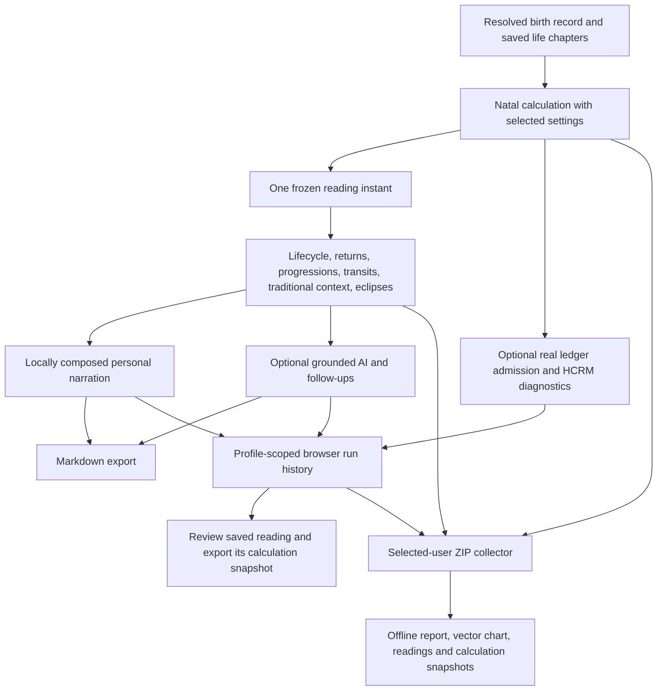

# Whole-app calculation and personal-reading audit

Audited starting commit: `517fc2e647c6f6d6ddf29346f770192a116f3df1`.
Scope: every browser entry point, chart and relationship consumers, input/time
resolution, astronomy, houses, traditional helpers, lifecycle calculations,
eclipses, ledger admission, integer core, narration, AI cache and local storage.
The repository's code, documentation, uploaded specifications and chat record
are the available baseline for earlier discoveries. A separate external research
record or deployed account system was not supplied.

## Result

The app implements a substantial tropical Western astrology system. It does not
implement every astrological tradition or technique. A tested integer division
or a named tradition in `variants.js` does not establish a working personal
reading for that tradition. Older documents claiming complete coverage and
unqualified production readiness are superseded by this report.

This repair fixes executable integration and calculation errors, and establishes
one personal context for each reading. It does not certify every interpretive
statement, prove the external physical claims, or guarantee that no further bugs
exist. Independent fixtures constrain numerical accuracy at their sampled dates;
passing tests do not establish superiority over all other implementations.

## Calculation coverage

| Area | Implemented and connected | Convention or remaining limit |
| --- | --- | --- |
| Birth entry | Calendar/coordinates validation, city IANA zones, DST resolution, names, unknown time, saved local profile | Ambiguous times choose the earlier instant with a notice; nonexistent times choose the next valid instant with a notice. Historical civil-time accuracy depends on browser ICU. |
| Planetary positions | Astronomy Engine 2.1.19 geocentric apparent tropical longitudes for Sun through Pluto; real signed daily speeds and declinations of date | Numerical ephemeris, not exact astronomy; geocentric rather than observer topocentric planetary positions. Unsupported Chiron omitted by default. |
| Nodes and Lilith | Mean North/South Node, mean lunar apogee; sources disclosed | True/osculating nodes and true Lilith are not implemented. |
| Houses | Whole sign, Equal, Porphyry and eight existing quadrant solvers: Placidus, Koch, Regiomontanus, Campanus, Alcabitius, Topocentric, Meridian, Morinus | Requested and actual systems recorded. Applicable polar failures fall back to Whole sign. Missing angle solver uses a corrected, explicitly approximate closed form. |
| Natal aspects | Shared major/minor/harmonic aspect definitions; orb scale applied before selection; signed instantaneous applying/separating, exact and stationary states | Closest eligible aspect per pair. Harmonic interpretations and configurable orbs are conventions. Declination parallels have a separate coordinate helper, not a full narrated panel. |
| Dignities and sect | Classical domicile/exaltation/detriment/fall, triplicity, Egyptian bounds, faces, joys, solar conditions, receptions, hayz helpers | No speculative outer-planet exaltations presented as Ptolemaic facts. Sect-dependent interpretation withheld for unknown time. Almuten is of the named Sun/Moon/ASC points, not full almuten figuris; Geniture helper is a documented estimate. |
| Lots and mirrors | Seven Hermetic Lots, Fortune and Spirit sect reversal, antiscia/contra-antiscia contacts | All formulas retained with their output. The earlier excerpt's unspecified eighth Lot is not a defined convention in the working chart; no extra formula is invented. |
| Moon | Physical illumination, centered eight-phase labels, actual prior/next phase searches, prenatal New/Full Moon and corrected dotted globe | Angle-only helper explicitly approximate. Equal tropical 28-mansion convention, not stellar mansion boundaries. |
| Fixed stars | Seven named J2000 catalogue stars transformed to birth date and checked against natal longitudes | Proper motion omitted and approximation disclosed; not a complete catalogue. |
| Time lords | Annual profections with completed age in birth zone; Bonatti major Firdaria; Fortune/Spirit level-1 zodiacal releasing | Firdaria uses 365.2425-day years. Releasing uses 360-day Egyptian years. Subperiods, loosing of the bond, alternate Firdaria orders and full releasing analysis are absent. |
| Live transits | Real positions/speeds; fixed natal targets including same-body returns; Persona exact-date searches, classic aspect/moiety options and CRAM observations | Persona searches twelve tightest contacts over 60 days; unsearched/unbracketed roots have no fabricated date. One-second stopping resolution is not one-second astronomical accuracy. The reading freezes its instant; the live panel/Persona watcher update independently. |
| Void of course | Moving Moon versus six other classical planets, five Ptolemaic aspects before actual sign ingress | One explicit classical convention, not every historical VOC definition. Unavailable solver fallback identified as approximate. |
| Progressions | Secondary day-for-year positions of Sun, Moon, Mercury, Venus and Mars; current signs and progressed phase in the personal reading | Not primary directions, tertiary progressions, solar-arc directions or all progressed angles. |
| Returns and residence | Real Solar/Lunar return roots; chart cast for residence active on the return date; location consistently reaches spoken lifecycle facts | Unknown birth time makes dates approximate. Lifecycle circuit count K separately uses mean periods; it does not integrate geocentric winding or retrograde loops. |
| Eclipses | Prenatal solar/lunar pair, lifetime contacts and upcoming events, geometry, sub-body coordinates, altitude and contact interpretation | Above horizon is necessary, not sufficient for local eclipse visibility. Angular/contact model limits remain displayed. |
| Synastry | Two explicitly owned natal charts, cross-aspects, actual selected-house overlays, receptions, relationship diagnostics, independent mutual perfections | Scores are chosen weights, not measured compatibility probabilities. Cyclic midpoint uses the circular mean; exactly antipodal phases are ambiguous. No full composite/Davison chart engine. |
| HCRM/CRAM | Strict admitted real-planet ledger, provenance/checksum, BigInt register/carry, shadow/closure diagnostics; exact arithmetic tests | Integer exactness starts after arcsecond quantization. Experimental residue coincidences are not physical or predictive evidence. Standalone console demonstration rows are not admitted production ledgers. |
| Other traditions | Integer registry of thirteen traditions, division/frame/period constants; Mayan calendar/CTM computations | Vedic/KP natal interpretation, date-dependent ayanamsas, Vimshottari schedules, yoga/shadbala/ashtakavarga, Bazi/Zi Wei and other named tradition-specific reading pipelines are not implemented by the registry. |
| Horary/electional | Some reusable traditional condition and aspect helpers | No complete horary/electional judgments, translation/collection of light, prohibition/frustration or chart rectification engine. |

## Personal data and run flow

`reading-context.jsx` captures a single UTC instant, exact input birth record,
user name, requested/actual house system, orb settings, residence history,
ephemeris source and model revision. Providers return their computed evidence or
an explicit unavailable status. No failed calculation is replaced by a plausible
reading. Saved evidence includes natal placements, Lots, aspects, patterns,
declinations, lunar phase, conditions, transits, residence and time techniques.
Optional advanced diagnostics attach their admitted ledger and registers to the
same saved run when opened. Persona's generated daily reading also retains its
actual watcher result and orb mode.

Run history preserves earlier inputs/evidence/readings rather than averaging
successive charts or changing natal positions. Same-run AI completions update
that run, with narrative segment provenance. Different inputs/instants produce
different records. Storage is capped at the latest 50 runs across profiles;
profile filtering prevents another person's readings appearing in the current
history. Malformed storage is ignored, failed writes are reported, and saved
JSON/Markdown can be exported. Records remain local to this browser. There is no
authentication, hosted personal-site backend or cross-device synchronization.
Same-run follow-up answers retain the question and answer on their
original profile even if the user navigates away before completion. Synastry
runs retain both entered birth records and the computed relationship evidence;
changing the partner creates a distinct input snapshot.

### Selected-user ZIP archive

`user-export.jsx` gathers the selected chart, composed reading, up to 50 owned
saved runs, matching local profile and Life Chapters. It calculates Solar/Lunar
return charts, progressions, relocated charts, the full eclipse profile and an
admitted ten-planet ledger with HCRM diagnostics at the captured reading
instant. Each provider has a ready/unavailable status; optional demonstration
registers remain separate from the admitted ledger. Relevant relationships
retain the partner data the user explicitly entered for that relationship.
Unrelated profiles and their run histories are excluded.

`src/astro/user-export.js` exports an ordinary compressed ZIP with an offline
`report.html`, `charts/natal.svg`, current reading, complete calculation JSON,
per-run JSON/text and a manifest with SHA-256 checksums when Web Crypto is
available. The report needs no scripts, fonts or network requests. It escapes
user content and sets a restrictive Content Security Policy. The collector
does not read arbitrary browser storage or cookies, invokes no data getters or
`toJSON`, omits credential fields, verifies run ownership against its birth
record and bounds snapshot depth, node count and total size. Paths are fixed
by the exporter rather than user input. Saving the ZIP preserves a portable
offline snapshot; it is not an automatic backup or live account service.

AI card/synthesis cache identities include the chart and personal evidence, so
previous 'today' facts and another user's chart cannot silently supply the next
reading. Pending hook results are bound to their chart/card/run. Export includes
the personal context and, when supplied, the full composed narration. Historical
AI synthesis is not substituted into a new run's export. AI remains opt-in and
its placement/aspect grounding validator is not an exhaustive natural-language
fact checker. Voice is also optional; its provider receives spoken text.

## Defects repaired beyond the Persona integration

- Empty sign cards previously attributed their borrowed ruler to the empty sign,
  with incorrect dignity, bounds, faces and house claims. Calculation, visible
  placement, accessibility labels, local speech, AI context and export now use
  the principal planet's actual placement.
- Natal Sun no longer receives an aspect to itself. Applying direction uses
  signed instantaneous error; a forward step cannot overshoot a very close
  aspect and invert it. Negative aspect separations normalize correctly.
- Orb scale previously changed only a filtered view after aspect selection. It
  now changes the actual natal calculation, including the session and export.
- Natal and lifecycle residue positions now use the ledger's nearest-arcsecond
  rounding, including circle wrap. Continuous longitude remains available.
- Live transit speeds now receive their actual epoch, and unsupported synthetic
  Chiron is absent from this path. Real ephemeris failures raise errors.
- Residence relocation now recasts location-dependent Lots, sect and card
  resonance. It previously kept cards whose houses and resonance belonged to
  the birthplace. Spoken returns now receive the same chapters as the panel.
- Synastry overlays now use actual quadrant cusps and actual polar fallback;
  an unclassified-only contact set cannot generate NaN compatibility values.
- The fallback Ascendant's wrong atan2 argument/branch was corrected. Main lunar
  illumination uses physical geometry and out-of-bounds uses obliquity of date.
  Non-planet points no longer alter the simplified planetary chart shape.
- Unknown time no longer produces certain sect, almuten or per-card natal-lane
  statements. Time-zone changes invalidate chart memos; same-epoch chart changes
  invalidate the live view, and intraday targets invalidate return calculations.

## Verification and remaining product work

The mandatory gates are the full native suite, 1,296,000-position ring sweep,
21-module no-float audit, independent JPL/Swiss fixture comparisons, lint,
ledger validation, reproducible standalone builds, browser navigation/storage/
history/mobile tests, and the README claim-banner consistency check. The
personal pipeline suite tests actual computed charts, retrograde velocities,
residence-specific returns, quadrant overlays, unknown-time suppression,
export/narration agreement and profile/run isolation. Archive tests verify
standard ZIP structure with independent decompression, file checksums, Unicode
filenames, secret-field omission, forged/foreign run exclusion and escaped
offline HTML. A browser test uses a fresh Sydney user with Porphyry houses,
downloads the archive, checks the real calculations and opens its report.

The next substantial product additions need defined conventions and independent
reference fixtures: true nodes/Lilith and Chiron ephemerides; full traditional
time-lord subperiods and horary; complete sidereal/Vedic and other tradition
engines; expanded star catalogue; primary/solar-arc directions and composite
charts; and an authenticated account/site system if cross-device personal
history is required. These are explicit gaps, not silently successful outputs.

Open issue #45's wider physics/proof assertions are not resolved by this repair.
The tested integer core remains intact; no mathematical or interpretive claim is
promoted solely because a test banner is green.
